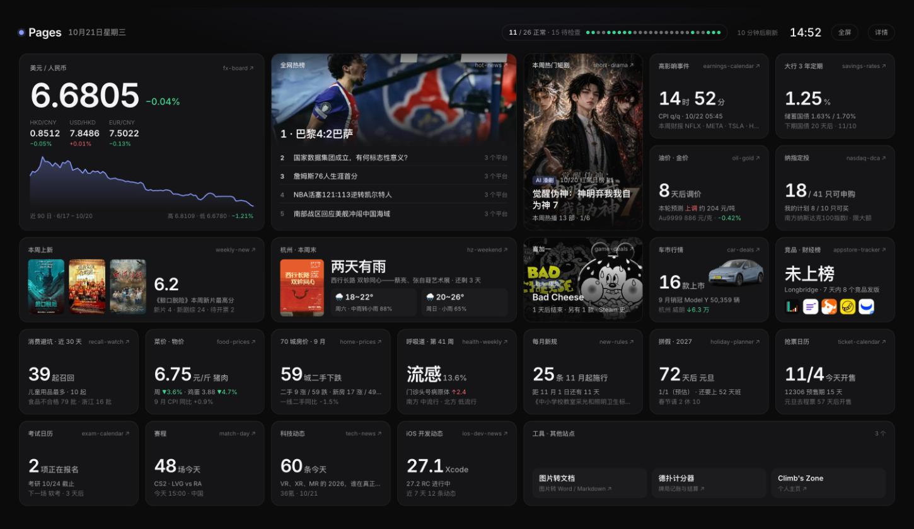

# 🧭 Pages · 今日

> 所有 GitHub Pages 站点的入口大屏：按 1920 宽等比缩放、可以上下滚动，站点多了往下加行，每格带今日要点（部分带封面），并监控每个站点的定时任务是否健康

**🌐 在线访问：[https://climb0516.github.io/pages-dashboard/](https://climb0516.github.io/pages-dashboard/)**（大屏）· [详情模式](https://climb0516.github.io/pages-dashboard/detail.html)

---

## 两种模式

| | 大屏（`index.html`） | 详情模式（`detail.html`） |
|---|---|---|
| 用途 | 挂在显示器上一直开着 | 手机、平时点进去细看 |
| 布局 | 1920 宽画布按窗口宽度等比缩放，高度不锁死、上下滚动，顶部栏固定；手机上自动变两列 | 卡片网格 + 右侧健康面板，可隐藏卡片，深浅主题 |
| 风格 | 暗色便当格：近黑底、圆角卡片、发丝细边、Inter 大号数字、单一强调色；热榜 / 短剧 / 上新 / 周末 / 喜加一 / 车市带封面图 | 与其他站点一致 |
| 动态 | 时钟、倒计时每分钟更新、短剧封面每 8 秒换一部；每 10 分钟刷新数据 | 每 10 分钟刷新 |

两边右上角互相切换；大屏按 **F** 或点右上角「全屏」进入全屏。

### 大屏布局（7 列便当格，每行固定高，卡片多了往下加行）



```
┌ ● Pages  10月21日 星期三 ……… 健康胶囊 + 每站一个状态点 · 刷新倒计时 · 时钟 · 全屏 · 详情 ┐
│ 汇率（2×2，90 日走势）│ 全网热榜（2×2，头图 + 前 5）│ 短剧封面（1×2）│ 高影响事件 │ 3 年定期 │
│                      │                           │               │ 油价金价   │ 纳指定投 │
│ 本周上新（海报 ×3）   │ 杭州本周末（展览海报 + 天气）│ 喜加一封面     │ 车市（车图）│ 竞品图标 │
│ 消费避坑 │ 菜价 │ 房价 │ 呼吸道 │ 新规 │ 拼假 │ 抢票                                             │
│ 考试 │ 赛程 │ 科技动态 │ iOS 开发 │ 工具 / 新站点：每个一格，先补满这一行，多了往下排 …      │
└────────────────────────────────────────────────────────────────────────────────┘
```

- 每格整张可点击进站；标题前的黄 / 红点表示该站健康检查有问题
- 顶栏健康胶囊：正常 / 注意 / 异常 / 待检查数量；小圆点悬停显示站名和问题，点击跳到该仓库 Actions
- 攻略地图卡片（2×2，固定在第一屏右上角）：背景是点亮的中国地图，实时读 `travel-guide-map/guides.json` 和 `china-lite.json`，做完新城市推送上线后自动点亮
- 站点清单在 `sites.js`（分组、名称、类型），健康点和「工具 / 新站点」小格都从这里读

---

## 详情模式功能

- **今日要点**（顶部四格）：下一个高影响宏观事件倒计时、USD/CNY、热榜第一、站点健康汇总
- **站点卡片**（每张右上角「进入 →」直达对应站点，× 可隐藏，隐藏设置只存在本机浏览器）

| 卡片 | 站点 | 展示 |
|---|---|---|
| 📊 市场 · 汇率 | market-board | 上证 / 恒指 / 纳指100，今日异动 6 只（重点股票里涨跌幅最大的，带 logo），USD/CNY、HKD/CNY、USD/HKD 及日涨跌，联系汇率位置，中间价与市场价差 |
| 📅 财报宏观 | earnings-calendar | 下一个高影响事件、下次 FOMC 倒计时，7 天内关注公司财报 |
| 📈 纳指定投 | nasdaq-dca | 基金总数、可申购数，我的定投计划各基金申购状态 |
| 🔥 全网热榜 | hot-news | 跨平台大事前 6 |
| ⚡ 科技动态 | tech-news | 最新 6 条（直连 Supabase） |
| 🍎 iOS 开发动态 | ios-dev-news | 最新 Xcode / iOS 正式版与进行中的 Beta / RC，7 天动态数，30 天内发版的库 |
| 📱 AppWatch 竞品 | appstore-tracker | 长桥、富途财经榜排名与评分，吐槽最多的主题，7 天内发版的竞品 |
| 🎬 短剧 | short-drama | 本周推荐前 3（带封面），AI 影响舆论温度条 |

- **站点健康**（右栏）：自动发现所有开启了 Pages 的仓库，逐个显示
  - 页面能否访问
  - 定时任务是否被停用（含「60 天无活动被 GitHub 停用」）
  - 最近一次运行时间、是否失败、是否太久没运行（超过 2 倍执行间隔 + 1 小时）
  - **停用倒计时**：公开仓库 60 天无提交，定时任务会被停用，进度条显示还剩几天
- 深色 / 浅色主题，手机适配，每 10 分钟自动刷新，倒计时每分钟更新

某张卡片读取失败或对应站点改了数据结构时，只有这张卡片显示提示，不影响其他卡片。

---

## 技术架构

```
GitHub Actions：health.yml（北京时间每小时第 41 分钟 / 手动 / 改了 scraper.py 或 health.yml 后 push）
  ↓ python scraper.py（只用标准库，GITHUB_TOKEN 认证 1000 次/小时，6 线程并发）
  ↓ GitHub API：列出 climb0516 所有 has_pages 仓库 → 各仓库 workflows、最近 15 次运行
  ↓ raw.githubusercontent.com 读 workflow 文件解析 cron（不占 API 额度）
  ↓ HEAD 各站页面检查返回码
  ↓ 判定 ok / warn / error → 写入 health.json 并 commit（updated 每次都变 = 心跳，自身不会因不活跃被停用）
       ↓
GitHub Pages（index.html 大屏 / detail.html 详情）
  ├─ sites.js → 站点清单（分组、名称、类型），健康点和「工具 / 新站点」格
  ├─ 读同目录 health.json → 站点健康
  ├─ 直接读各站线上 data.json / picks.json / exams.json / guides.json 等（同域名 climb0516.github.io，无跨域问题）
  └─ tech-news 的 Supabase（页面公开的 anon 只读 key）→ 科技动态卡片
       ↓
卡片链接带 #/item/<类型>/<id> → 打开目标站对应条目的详情抽屉
```

### 新站点怎么接入

- **站点健康**：无需改动，开启 Pages 后下一次检查自动出现
- **大屏**：在 `sites.js` 对应分组里加一行 `{ repo, name, group, kind }`，新站点会自动在网格末尾多出一个「新站点」小格（页面往下长，不用改布局）；要做专属卡片，在 `index.html` 的 `CARDS` 里加一项 `{ key, repo, load, render }`，再把 `key` 放进 `LAYOUT`（网格会自动往下加行，不用再挤一屏）
- **详情模式**：在 `detail.html` 的 `SITES` 数组里加一项 `{ repo, title, color, load, render }`（同一站点有多张卡片时再加 `key` 区分、`path` 指定进入的模块，如 market-board）。大屏和详情各有一份读取逻辑，改字段时两处都要改

### 各卡片依赖的字段（对应站点改结构时检查这里）

| 站点 | 字段 |
|---|---|
| market-board（market.json、fx.json、config.json、logos/） | `quotes[id].{f2,f3,f14}`（id 为东方财富代码，如 `1.000001`）、`config.stocks`（今日异动的候选名单）、`logos/{id}.png`；`ref.rates`、`history`、`cfets` |
| earnings-calendar | `today_et`、`watchlist`、`macro[].{time,impact,kind,title}`、`earnings[].{date,symbol,name,time,watch}` |
| nasdaq-dca | `plan[].{code,app}`、`funds[].{code,name,status,status_raw}` |
| hot-news | `events[].{title,image,platforms[].url}` |
| tech-news | Supabase `news_items`：`title,source,date,url` |
| ios-dev-news | `items[].{kind,platform,stage,version,date}`、`libs[].{name,version,date,url}` |
| appstore-tracker | `apps[].{key,name,rank,rating,version,version_date,region,url,review_stats.topics}`、`topics` |
| short-drama | `picks.json` 的 `items[].{title,form,rank_note,cover}`、`data.json` 的 `ai[].{time,sentiment}` |
| market-board（oilgold.json） | `oil.{next_window,estimate,national}`、`gold.quotes.au9999` |
| savings-rates | `deposit.rates`、`bonds[].{start,end,kind,items[].{term,rate}}` |
| health-weekly | `weeks[0].{week,outpatient,level}` |
| holiday-planner | `summary.{plan_year,next,top}` |
| weekly-new | `movies.showing[].{title,rating,release,cover_local,cover}`、`tv[].{pubdate,pub_precise}`、`news.concert[]` |
| hz-weekend | `weekend`、`daily[].{date,tmin,tmax,text,pop,rain}`、`exhibitions[].{title,img,start,end,venue}` |
| game-deals | `epic[].{kind,title,img,end}`、`summary.steam_lows` |
| car-deals | `cuts[城市].items[].{name,cut,pct}`、`sales[月份][].{name,img,sales}`、`launches[].{status,date}` |
| recall-watch | `recalls[].{kind,date,cat}`、`fails[].{kind,src,date}` |
| food-prices | `xinfadi.{pork_lean,egg}`、`cpi` |
| home-prices | `summary.{month,counts,tiers}` |
| new-rules | `items[].{date,region,kind,name,title,articles}` |
| ticket-calendar | `holidays[].{name,start}` |
| exam-calendar | `exams.json` 的 `exams[].{short,sessions[].events[].{type,start,end}}` |
| match-day | `events[].{ts,sport,game,league,home,away,stage,china,major}` |
| travel-guide-map | `guides.json` 的 `[].{adcode,days,updated,title,city}`、`china-lite.json` 的 `vb`、`prov`、`units[].{a,p,c,d}` |

---

## 数据来源

**汇总的站点**：`sites.js` 里 26 个（财经 4、资讯 4、生活 6、出行娱乐 9、工具 3）；健康检查另外按 GitHub API 自动发现，当前 `health.json` 里 26 个仓库。

| 来源 | 方式 | 条数/范围 | 备注 |
|------|------|-----------|------|
| GitHub REST API | `scraper.py`：`/users/climb0516/repos?per_page=100&type=owner` → 过滤 `has_pages` 且未归档 | 所有开了 Pages 的仓库（含自己） | Actions 里用 `GITHUB_TOKEN`（1000 次/小时），本地无 token 60 次/小时 |
| GitHub REST API | `/repos/climb0516/<repo>/actions/workflows` + 每个 workflow `runs?per_page=15` | 每个仓库全部 workflow（排除 `dynamic/` 开头的 pages-build-deployment），每个取最近 15 次运行 | 一次完整检查约 25 次请求 |
| raw.githubusercontent.com | 读 workflow 文件，正则取 `cron: '...'` | 每个 workflow 第一条 cron | 不占 API 额度 |
| 各站页面 | `HEAD https://climb0516.github.io/<repo>/`（用户主页仓库用根地址） | 每站 1 次 | 超时 15 秒 |
| `health.json` | 两个页面读同目录文件 | 1 个 | 由 workflow 每小时生成 |
| 各站线上数据文件 | 浏览器直接 `fetch`（同域名，`cache: 'no-cache'`） | 大屏 24 张卡片 / 详情 21 张卡片，见下表 | 读取失败只影响对应卡片 |
| tech-news 的 Supabase | REST `news_items`：大屏取 60 条（`id,title,source,date,image_url`）、详情取 6 条（`title,source,date,url`），按 `date.desc,created_at.desc` | — | 页面里是 tech-news 公开的 anon 只读 key（README 不抄写） |

**大屏卡片读取的文件**（`index.html` 的 `CARDS`，详情模式 `detail.html` 的 `SITES` 读同样的文件）

| 卡片 key | 站点 | 文件 | 详情模式 |
|---------|------|------|---------|
| fx | market-board | `market.json`、`fx.json`、`config.json`、`logos/{id}.png` | 有 |
| oil | market-board | `oilgold.json` | 有 |
| macro | earnings-calendar | `data.json` | 有 |
| save | savings-rates | `data.json` | 有 |
| dca | nasdaq-dca | `data.json` | 有 |
| hot | hot-news | `data.json` | 有 |
| tech | tech-news | Supabase `news_items` | 有 |
| ios | ios-dev-news | `data.json` | 有 |
| apps | appstore-tracker | `data.json` | 有 |
| weekend | hz-weekend | `data.json` | 无 |
| recall | recall-watch | `data.json` | 无 |
| food | food-prices | `data.json` | 有 |
| home | home-prices | `data.json` | 有 |
| resp | health-weekly | `data.json` | 有 |
| rules | new-rules | `data.json` | 有 |
| holiday | holiday-planner | `data.json` | 有 |
| ticket | ticket-calendar | `data.json` | 有 |
| exam | exam-calendar | `exams.json` | 有 |
| match | match-day | `data.json` | 有 |
| weekly | weekly-new | `data.json` | 有 |
| drama | short-drama | `picks.json`、`data.json` | 有 |
| game | game-deals | `data.json` | 有 |
| car | car-deals | `data.json` | 有 |
| guide | travel-guide-map | `guides.json`、`china-lite.json` | 无 |
| tools | img2doc、poker-score、Climb0516.github.io | 不读数据，`sites.js` 里没有专属卡片的站点自动出现 | — |

---

## 数据处理规则

健康检查都在 `scraper.py` 的 `check_repo()` 里判定，`main()` 用 6 个线程并发检查。

| 规则 | 函数 / 字段 | 阈值 | 级别 |
|------|------------|------|------|
| 页面不可访问 | `page_status()` | 返回码不是 200（异常记 0 = 无法访问） | error |
| 定时任务被停用 | workflow `state` | 不是 `active`；`disabled_inactivity` 显示「60 天无活动被 GitHub 停用」 | error |
| 最近一次运行失败 | `last_run.conclusion` | 已完成且不是 `success` / `skipped` | error |
| 太久没运行 | `cron_interval_hours()` + `last_scheduled_at` / 最近任意一次运行 | 距今超过 `间隔 × 2 + 1` 小时 | warn |
| 停用倒计时 | `days_left = INACTIVE_DAYS − idle_days`，`INACTIVE_DAYS = 60` | 有 cron 且剩余 < 14 天：> 0 天 warn，≤ 0 天 error | warn / error |
| 检查本身出错 | `_safe()` | 任何异常 | warn（「健康检查失败」） |

- `cron_interval_hours()` 粗估间隔：小时位是 `*` → 1 小时；`*/n` → n 小时；逗号列表 → 24 ÷ 个数；日或星期有限定 → 168 小时（一周）；其余 → 24 小时
- 「太久没运行」以最近一次定时运行和最近一次任意运行（手动 / push）中较晚的为准，刚上线或刚修好的站不误报
- `idle_days` 按仓库 `pushed_at` 算；`level` 有 error 就是 error，有问题就是 warn，否则 ok
- 排序：error → warn → ok，同级按最近推送时间倒序
- 前端：大屏顶栏按 `sites.js` 统计「正常 / 注意 / 异常 / 待检查」，`sites.js` 里有但 health.json 里没有的算「待检查」

---

## 数据结构

### health.json

```
{
  "updated": "2026-11-03T18:00:12+08:00",   北京时间，每次运行都变（心跳）
  "owner": "climb0516",
  "authenticated": true,                     是否带 token 运行
  "repos": [
    {
      "name": "market-board",
      "page": "https://climb0516.github.io/market-board/",
      "repo_url": "https://github.com/climb0516/market-board",
      "description": "",
      "pushed_at": "2026-11-03T03:30:54Z",
      "idle_days": 0.3,
      "days_left": 59.7,
      "page_status": 200,
      "workflows": [
        {
          "name": "Market Board Scraper",
          "path": ".github/workflows/scrape.yml",
          "state": "active",
          "url": "https://github.com/.../scrape.yml",
          "cron": "23 * * * *",
          "interval_h": 1,
          "last_run": {"status", "conclusion", "event", "created_at", "url"},
          "last_success_at": "...",
          "last_scheduled_at": "..."
        }
      ],
      "issues": [{"level": "warn", "text": "Market Board Scraper：超过 3 小时没有运行"}],
      "level": "warn"                         ok | warn | error
    }
  ]
}
```

### sites.js

```
window.PAGES_SITES = [
  { repo: 'market-board', name: '市场看板', group: '财经', kind: 'data' },
  { repo: 'img2doc', name: '图片转文档', group: '工具', kind: 'tool', desc: '图片转 Word / Markdown', icon: '🖼' },
  { repo: 'Climb0516.github.io', name: "Climb's Zone", group: '工具', kind: 'tool', desc: '个人主页', icon: '🧗', url: 'https://climb0516.github.io/' },
]
kind：'data' 有数据文件的站 / 'tool' 静态工具页；url 可选，覆盖默认地址
```

### 浏览器本地存储（详情模式）

```
localStorage
├── pd:hidden   被隐藏的卡片 key 数组
└── pd:theme    'dark'（默认）| 'light'
```

---

## 前端

- **大屏 `index.html`**：原生 JS，无构建；`CARDS`（每项 `{ key, repo, load, render }`）+ `LAYOUT`（24 张卡片 + 末尾 `tools` 格，CSS grid 自动往下排）
  - `fit()`：窗口宽度 > 760px 时 `#stage` 按 `clientWidth / 1920` 设 `zoom`，只按宽度缩放、高度随内容滚动；≤ 760px 不缩放，变两列
  - `load()`：先并发拉各卡片数据（`Promise.allSettled`），再读 `health.json` 刷新标题前的状态点；`renderCard()` 出错时只这一格显示「读取失败」或「数据格式已变化」
  - 定时：时钟每秒、宏观倒计时每 60 秒、短剧封面每 8 秒轮播、数据每 10 分钟（`REFRESH_MS`）
  - 全屏：按 F 或点「全屏」（`requestFullscreen`）
  - 调试：`?origin=http://localhost:端口/` 改成读本地各站数据（默认 `https://climb0516.github.io/`）
- **详情模式 `detail.html`**：`SITES` 数组（每项 `{ repo, title, color, load, render }`，多卡片同站用 `key`、`path` 区分）；右栏健康面板读 `health.json`；卡片可隐藏、深浅主题切换存 localStorage
- **深链到各站详情抽屉**：本站自己不用 kit 组件（没有 `kit-sheet`），但卡片链接会带上目标站的 kit 路由，点进去直接打开那一条的详情抽屉（电脑右侧滑出、手机底部升起）。卡片整体链接存在 `GO[key]`，卡片里单独的行 / 海报用 `data-go` 属性：

| 卡片 | 目标站 | 路由 |
|------|-------|------|
| hot | hot-news | `#/item/event/<id>` |
| drama | short-drama | `#/item/pick/<标题>` |
| save | savings-rates | `#/item/rate/0` |
| dca | nasdaq-dca | `#/list/funds` |
| weekly | weekly-new | `#/item/movie/<id>` |
| car | car-deals | `#/item/series/<id>` |
| apps | appstore-tracker | `#/item/app/<key>` |
| recall | recall-watch | `#/item/rc/<id>`，没有时 `#/list/recalls` |
| food | food-prices | `#/item/veg/pork_lean` |
| home | home-prices | `#/item/month/<月份>` |
| resp | health-weekly | `#/item/pathogen/<名称>` |
| rules | new-rules | `#/item/rule/<id>` |
| holiday | holiday-planner | `#/item/day/cn-<日期>` |
| ticket | ticket-calendar | `#/item/holiday/<年-名称>` |
| exam | exam-calendar | `#/item/exam/<id>` |
| match | match-day | `#/item/match/<id>` |
| tech | tech-news | `#/item/news/<id>` |
| ios | ios-dev-news | `#/item/ver/Xcode` |

  条目已下榜、目标站找不到这条时的提示由目标站的 kit 组件负责，本站不处理。
- **攻略地图卡片**（2×2）：用 `china-lite.json` 的 `units` 画全国底图，`guides.json` 里 `adcode` 对应的城市橙色填充 + 光点，前景写「N 城 N 省 N 天」和最新一份攻略；目前只读 `adcode`，不读 `also_adcodes`

---

## 本地运行

```
python3 -m http.server 8797
# 大屏 http://localhost:8797 · 详情 http://localhost:8797/detail.html
```

本地运行 `scraper.py` 时没有 token，只有 60 次/小时额度，一次完整检查约 25 次，别频繁跑；可以 `GITHUB_TOKEN=xxx python3 scraper.py`。

---

## 自动更新机制

| 触发方式 | 时机 |
|---------|------|
| GitHub Actions 定时任务（`health.yml`） | cron `41 * * * *`（UTC）= 北京时间每小时第 41 分钟，错开各站抓取高峰；GitHub 定时任务常有延迟 |
| push 到 main | 只有改了 `scraper.py` 或 `.github/workflows/health.yml` 才触发 |
| 手动 dispatch | Actions 页面「Run workflow」 |
| 页面自动刷新 | 大屏、详情模式每 10 分钟重新读 health.json 和各站数据 |

- **心跳文件**：`health.json` 的 `updated` 每次运行都变，所以每次都会提交（提交信息 `data: health <北京时间>`），仓库始终有新提交
- **60 天停用**：公开仓库 60 天无提交，GitHub 会自动停用定时任务（需要到 Actions 页面重新启用）。本仓库靠上面的心跳提交保持活跃；对其他站点，健康检查会在剩余不到 14 天时提示、停用后标红
- workflow 用 `concurrency: health`（不取消进行中的运行），提交前 `git pull --rebase` 避免冲突；Python 3.12，`permissions: contents: write, actions: read`
