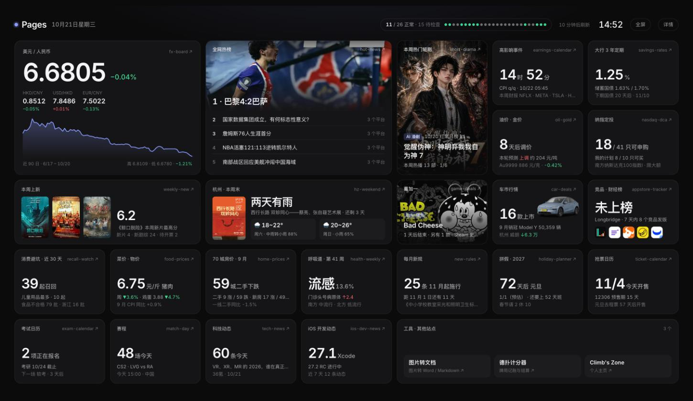

# 🧭 Pages · 今日

> 所有 GitHub Pages 站点的入口大屏：一屏放下全部站点，每格带今日要点（部分带封面），并监控每个站点的定时任务是否健康

**🌐 在线访问：[https://climb0516.github.io/pages-dashboard/](https://climb0516.github.io/pages-dashboard/)**（大屏）· [详情模式](https://climb0516.github.io/pages-dashboard/detail.html)

---

## 两种模式

| | 大屏（`index.html`） | 详情模式（`detail.html`） |
|---|---|---|
| 用途 | 挂在显示器上一直开着 | 手机、平时点进去细看 |
| 布局 | 1920×1080 等比缩放铺满窗口，不滚动；手机上自动变单列 | 卡片网格 + 右侧健康面板，可隐藏卡片，深浅主题 |
| 风格 | 暗色便当格：近黑底、圆角卡片、发丝细边、Inter 大号数字、单一强调色；热榜 / 短剧 / 上新 / 周末 / 喜加一 / 车市带封面图 | 与其他站点一致 |
| 动态 | 时钟、倒计时每分钟更新、短剧封面每 8 秒换一部；每 10 分钟刷新数据 | 每 10 分钟刷新 |

两边右上角互相切换；大屏按 **F** 或点右上角「全屏」进入全屏。

### 大屏布局（7 列 × 5 行便当格，全部站点一屏放下）



```
┌ ● Pages  10月21日 星期三 ……… 健康胶囊 + 每站一个状态点 · 刷新倒计时 · 时钟 · 全屏 · 详情 ┐
│ 汇率（2×2，90 日走势）│ 全网热榜（2×2，头图 + 前 5）│ 短剧封面（1×2）│ 高影响事件 │ 3 年定期 │
│                      │                           │               │ 油价金价   │ 纳指定投 │
│ 本周上新（海报 ×3）   │ 杭州本周末（展览海报 + 天气）│ 喜加一封面     │ 车市（车图）│ 竞品图标 │
│ 消费避坑 │ 菜价 │ 房价 │ 呼吸道 │ 新规 │ 拼假 │ 抢票                                             │
│ 考试 │ 赛程 │ 科技动态 │ iOS 开发 │ 工具 · 其他站点（工具页 + 还没有专属卡片的新站点）      │
└────────────────────────────────────────────────────────────────────────────────┘
```

- 每格整张可点击进站；标题前的黄 / 红点表示该站健康检查有问题
- 顶栏健康胶囊：正常 / 注意 / 异常 / 待检查数量；小圆点悬停显示站名和问题，点击跳到该仓库 Actions
- 站点清单在 `sites.js`（分组、名称、类型），健康点和「工具 · 其他站点」格都从这里读

---

## 详情模式功能

- **今日要点**（顶部四格）：下一个高影响宏观事件倒计时、USD/CNY、热榜第一、站点健康汇总
- **站点卡片**（每张右上角「进入 →」直达对应站点，× 可隐藏，隐藏设置只存在本机浏览器）

| 卡片 | 站点 | 展示 |
|---|---|---|
| 📊 市场 · 汇率 | market-board | 上证 / 恒指 / 纳指100，今日异动 6 只（重点股票里涨跌幅最大的，带 logo），USD/CNY、HKD/CNY、USD/HKD 及日涨跌，联系汇率位置，中间价与市场价差 |
| 📅 财报宏观 | earnings-calendar | 下一个高影响事件、下次 FOMC 倒计时，7 天内关注公司财报 |
| 📈 纳指定投 | nasdaq-dca | 基金总数、可申购数，我的定投计划各基金申购状态 |
| 🔥 全网热榜 | hot-news | 跨平台大事前 6 |
| ⚡ 科技动态 | tech-news | 最新 6 条（直连 Supabase） |
| 🍎 iOS 开发动态 | ios-dev-news | 最新 Xcode / iOS 正式版与进行中的 Beta / RC，7 天动态数，30 天内发版的库 |
| 📱 AppWatch 竞品 | appstore-tracker | 长桥、富途财经榜排名与评分，吐槽最多的主题，7 天内发版的竞品 |
| 🎬 短剧 | short-drama | 本周推荐前 3（带封面），AI 影响舆论温度条 |
| market-board（oilgold.json） | `oil.{next_window,estimate,national}`、`gold.quotes.au9999` |
| savings-rates | `deposit.rates`、`bonds[].{start,end,kind,items[].{term,rate}}` |
| health-weekly | `weeks[0].{week,outpatient,level}` |
| holiday-planner | `summary.{plan_year,next,top}` |
| weekly-new | `movies.showing[].{title,rating,release,cover_local,cover}`、`tv[].{pubdate,pub_precise}`、`news.concert[]` |
| hz-weekend | `weekend`、`daily[].{date,tmin,tmax,text,pop,rain}`、`exhibitions[].{title,img,start,end,venue}` |
| game-deals | `epic[].{kind,title,img,end}`、`summary.steam_lows` |
| car-deals | `cuts[城市].items[].{name,cut,pct}`、`sales[月份][].{name,img,sales}`、`launches[].{status,date}` |
| recall-watch | `recalls[].{kind,date,cat}`、`fails[].{kind,src,date}` |
| food-prices | `xinfadi.{pork_lean,egg}`、`cpi` |
| home-prices | `summary.{month,counts,tiers}` |
| new-rules | `items[].{date,region,kind,name,title,articles}` |
| ticket-calendar | `holidays[].{name,start}` |
| exam-calendar | `exams.json` 的 `exams[].{short,sessions[].events[].{type,start,end}}` |
| match-day | `events[].{ts,sport,game,league,home,away,stage,china,major}` |

- **站点健康**（右栏）：自动发现所有开启了 Pages 的仓库，逐个显示
  - 页面能否访问
  - 定时任务是否被停用（含「60 天无活动被 GitHub 停用」）
  - 最近一次运行时间、是否失败、是否太久没运行（超过 2 倍执行间隔 + 1 小时）
  - **停用倒计时**：公开仓库 60 天无提交，定时任务会被停用，进度条显示还剩几天
- 深色 / 浅色主题，手机适配，每 10 分钟自动刷新，倒计时每分钟更新

某张卡片读取失败或对应站点改了数据结构时，只有这张卡片显示提示，不影响其他卡片。

---

## 技术架构

```
GitHub Actions（每小时第 41 分钟 / 手动 / 修改脚本后 push）
  ↓ python scraper.py（只用标准库，GITHUB_TOKEN 认证 1000 次/小时）
  ↓ GitHub API：列出 climb0516 所有 has_pages 仓库 → 各仓库 workflows、最近 15 次运行
  ↓ raw.githubusercontent.com 读 workflow 文件解析 cron（不占 API 额度）
  ↓ HEAD 各站页面检查返回码
  ↓ 写入 health.json 并 commit（updated 每次都变 = 心跳，自身不会因不活跃被停用）
       ↓
GitHub Pages（index.html 大屏 / detail.html 详情）
  ├─ 读同目录 health.json → 站点健康
  └─ 直接读各站线上 data.json / picks.json（同域名 climb0516.github.io，无跨域问题）
     以及 tech-news 的 Supabase（页面公开的 anon 只读 key）→ 今日要点卡片
```

### 新站点怎么接入

- **站点健康**：无需改动，开启 Pages 后下一次检查自动出现
- **大屏**：在 `sites.js` 对应分组里加一行 `{ repo, name, group, kind }`，新站点会先出现在「工具 · 其他站点」格里；要做专属卡片，在 `index.html` 的 `CARDS` 里加一项 `{ key, repo, load, render }`，再把 `key` 放进 `LAYOUT`（7×5 格子已排满，需要同时调整布局）
- **详情模式**：在 `detail.html` 的 `SITES` 数组里加一项 `{ repo, title, color, load, render }`（同一站点有多张卡片时再加 `key` 区分、`path` 指定进入的模块，如 market-board）。大屏和详情各有一份读取逻辑，改字段时两处都要改

### 各卡片依赖的字段（对应站点改结构时检查这里）

| 站点 | 字段 |
|---|---|
| market-board（market.json、fx.json、config.json、logos/） | `quotes[id].{f2,f3,f14}`（id 为东方财富代码，如 `1.000001`）、`config.stocks`（今日异动的候选名单）、`logos/{id}.png`；`ref.rates`、`history`、`cfets` |
| earnings-calendar | `today_et`、`watchlist`、`macro[].{time,impact,kind,title}`、`earnings[].{date,symbol,name,time,watch}` |
| nasdaq-dca | `plan[].{code,app}`、`funds[].{code,name,status,status_raw}` |
| hot-news | `events[].{title,image,platforms[].url}` |
| tech-news | Supabase `news_items`：`title,source,date,url` |
| ios-dev-news | `items[].{kind,platform,stage,version,date}`、`libs[].{name,version,date,url}` |
| appstore-tracker | `apps[].{key,name,rank,rating,version,version_date,region,url,review_stats.topics}`、`topics` |
| short-drama | `picks.json` 的 `items[].{title,form,rank_note,cover}`、`data.json` 的 `ai[].{time,sentiment}` |

---

## 本地预览

```
python3 -m http.server 8797
# 大屏 http://localhost:8797 · 详情 http://localhost:8797/detail.html
```

本地运行 `scraper.py` 时没有 token，只有 60 次/小时额度，一次完整检查约 25 次，别频繁跑；可以 `GITHUB_TOKEN=xxx python3 scraper.py`。
